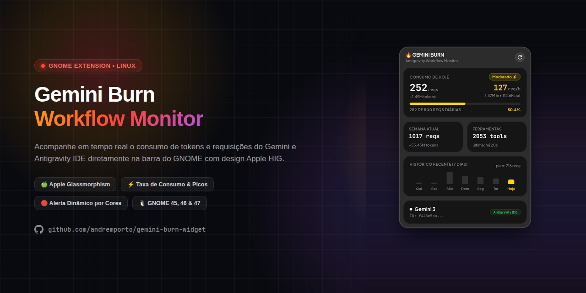

# 🔥 gemini-burn

<p align="center">
  
</p>

<p align="center">
  <b>English</b> · <a href="README.pt-BR.md">Português (BR)</a>
</p>

<p align="center">
  <b>Real-time Gemini & Antigravity request, token burn rate, and quota monitor for macOS.</b><br>
  Native macOS host app and SwiftUI <b>WidgetKit</b> extension powered by a zero-config local telemetry backend.
</p>

<p align="center">
  
  
  
  
</p>

---

## ✨ Features

- **Native macOS WidgetKit Extension (`Small`, `Medium`, `Large`)**:
  - **Small**: Today's request count, formatted token total, hourly pace (`req/h`), progress bar, and percentage.
  - **Medium**: Today's metrics (`in` / `out` tokens, daily quota progress) alongside weekly summary and a 7-day bar chart.
  - **Large**: Full breakdown including daily/weekly totals, tool call counter, active model, 7-day peak chart, and last sync timestamp.
- **Dynamic Status Colors**:
  - 🟢 **0% – 49%**: Green (normal pace)
  - 🟠 **50% – 69%**: Orange (moderate consumption)
  - 🔴 **70%+**: Red (high burn rate)
- **Zero-Config Local Telemetry**:
  - Reads local Antigravity / Gemini session logs directly with no API keys required.
  - Embedded Python backend runs locally on `127.0.0.1` (default port `5678`, automatic fallback if busy).
- **Multi-Mode Support**:
  - Native macOS `.app` bundle with embedded WidgetKit extension (`GeminiBurnMac/`).
  - Standalone web dashboard (`--web`) and terminal CLI (`--cli`) via the bundled `gemini-burn-widget/` backend.

---

## 📁 Project Structure

```text
gemini-burn/
├── GeminiBurnMac/                # Native macOS app & WidgetKit extension (Swift / SwiftUI)
│   ├── Package.swift
│   ├── build.sh                  # Builds gemini-burn.app + GeminiBurnWidget.appex
│   └── Sources/
│       ├── GeminiBurnMac/        # Host app & Python backend lifecycle manager
│       └── GeminiBurnWidget/     # WidgetKit timeline provider & Small/Medium/Large views
├── gemini-burn-widget/           # Python log parser, local HTTP API, Web UI & CLI
├── LICENSE                       # MIT License
├── README.md
└── README.pt-BR.md
```

---

## 📋 Requirements

- **macOS 14.0+** (Sonoma or newer, required for WidgetKit desktop widgets)
- **Xcode Command Line Tools** (`swiftc`, `xcrun`, `codesign`, `lipo`)
- **Python 3** (`/opt/homebrew/bin/python3`, `/usr/local/bin/python3`, or `/usr/bin/python3`)

---

## 🚀 Build & Installation

### 1. Clone the repository

```bash
git clone https://github.com/alexandrehenriqueventura/gemini-burn.git
cd gemini-burn
```

### 2. Build the macOS app and WidgetKit extension

```bash
./GeminiBurnMac/build.sh
```

Available flags:

| Flag | Description |
| :--- | :--- |
| *(none)* | Builds `GeminiBurnMac/.build/gemini-burn.app` for the host architecture |
| `--universal` | Builds a Universal Binary (`arm64` + `x86_64`) |
| `--install` | Copies `gemini-burn.app` to `/Applications/gemini-burn.app` |
| `--run` | Launches the built `.app` bundle after compilation |

Example — build, install to `/Applications`, and launch:

```bash
./GeminiBurnMac/build.sh --install --run
```

### 3. Add the Widget to your macOS Desktop or Notification Center

1. Right-click on your macOS desktop and select **Edit Widgets...** (or open Notification Center → **Edit Widgets**).
2. Search for **Gemini Burn**.
3. Choose **Small**, **Medium**, or **Large** and add it to your desktop or sidebar.

> [!NOTE]
> The app uses ad-hoc code signing (`codesign --force --sign -`) and registers the WidgetKit extension via `pluginkit -a`. Keep `gemini-burn.app` running in the background so the local telemetry endpoint stays active for widget updates.

---

## 🖥️ Standalone Backend Modes (Web / CLI)

You can also run the bundled Python backend directly:

```bash
# Local Web Dashboard (http://127.0.0.1:5678/)
python3 gemini-burn-widget/main.py --web

# Interactive Terminal CLI Dashboard
python3 gemini-burn-widget/main.py --cli
```

---

## 🔒 Privacy

All log parsing and HTTP serving happen **100% locally** on `127.0.0.1`. No telemetry, prompts, tokens, or usage data leave your machine.

---

## 🙏 Acknowledgements

- Built upon the telemetry parser, local web dashboard, and Apple-inspired widget design of [gemini-burn-widget](https://github.com/andremporto/gemini-burn-widget) by **André Porto** (MIT License).

---

## 📄 License

This project is licensed under the **MIT License** — see the [LICENSE](LICENSE) file for details.
