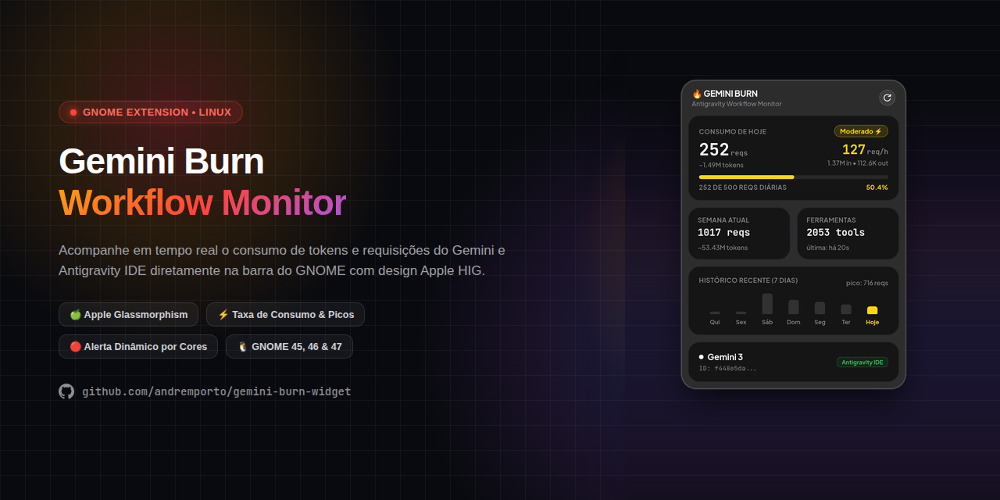

# 🔥 gemini-burn

<p align="center">
  
</p>

<p align="center">
  <a href="README.md">English</a> · <b>Português (BR)</b>
</p>

<p align="center">
  <b>Monitor em tempo real de requisições, taxa de queima de tokens e cota do Gemini e Antigravity para macOS.</b><br>
  App nativo para macOS com extensão <b>WidgetKit</b> em SwiftUI alimentado por um backend local sem necessidade de configuração.
</p>

<p align="center">
  
  
  
  
</p>

---

## ✨ Funcionalidades

- **Extensão Nativa WidgetKit para macOS (`Small`, `Medium`, `Large`)**:
  - **Small**: Requisições de hoje, total de tokens formatado, ritmo por hora (`req/h`), barra de progresso e percentual.
  - **Medium**: Métricas de hoje (tokens `in` / `out` e progresso da meta diária) junto com o resumo semanal e gráfico de barras dos últimos 7 dias.
  - **Large**: Visão completa com totais diário e semanal, contador de ferramentas, modelo ativo, gráfico de 7 dias com pico e horário da última atualização.
- **Cores Dinâmicas de Status**:
  - 🟢 **0% – 49%**: Verde (ritmo normal)
  - 🟠 **50% – 69%**: Laranja (consumo moderado)
  - 🔴 **70%+**: Vermelho (ritmo acelerado)
- **Telemetria Local Sem Configuração**:
  - Analisa diretamente os logs locais de sessão do Antigravity / Gemini, sem precisar de chaves de API.
  - O backend Python embarcado roda localmente em `127.0.0.1` (porta padrão `5678`, com fallback automático se ocupada).
- **Múltiplos Modos de Uso**:
  - Pacote nativo macOS (`.app`) com extensão WidgetKit integrada (`GeminiBurnMac/`).
  - Dashboard web local (`--web`) e painel interativo no terminal (`--cli`) via backend `gemini-burn-widget/`.

---

## 📁 Estrutura do Projeto

```text
gemini-burn/
├── GeminiBurnMac/                # App nativo macOS e extensão WidgetKit (Swift / SwiftUI)
│   ├── Package.swift
│   ├── build.sh                  # Compila gemini-burn.app + GeminiBurnWidget.appex
│   └── Sources/
│       ├── GeminiBurnMac/        # App host e gerenciador do backend Python
│       └── GeminiBurnWidget/     # TimelineProvider e views Small/Medium/Large do WidgetKit
├── gemini-burn-widget/           # Parser de logs em Python, API HTTP local, Web UI e CLI
├── LICENSE                       # Licença MIT
├── README.md
└── README.pt-BR.md
```

---

## 📋 Requisitos

- **macOS 14.0+** (Sonoma ou superior, necessário para widgets na mesa do macOS)
- **Xcode Command Line Tools** (`swiftc`, `xcrun`, `codesign`, `lipo`)
- **Python 3** (`/opt/homebrew/bin/python3`, `/usr/local/bin/python3` ou `/usr/bin/python3`)

---

## 🚀 Compilação e Instalação

### 1. Clonar o repositório

```bash
git clone https://github.com/alexandrehenriqueventura/gemini-burn.git
cd gemini-burn
```

### 2. Compilar o app macOS e a extensão WidgetKit

```bash
./GeminiBurnMac/build.sh
```

Opções disponíveis:

| Flag | Descrição |
| :--- | :--- |
| *(nenhuma)* | Compila `GeminiBurnMac/.build/gemini-burn.app` para a arquitetura atual |
| `--universal` | Compila um Binário Universal (`arm64` + `x86_64`) |
| `--install` | Copia `gemini-burn.app` para `/Applications/gemini-burn.app` |
| `--run` | Abre o `.app` compilado após o build |

Exemplo — compilar, instalar em `/Applications` e abrir:

```bash
./GeminiBurnMac/build.sh --install --run
```

### 3. Adicionar o Widget na Mesa ou Central de Notificações

1. Clique com o botão direito na mesa do macOS e selecione **Editar Widgets...** (ou abra a Central de Notificações → **Editar Widgets**).
2. Pesquise por **Gemini Burn**.
3. Escolha o tamanho **Pequeno**, **Médio** ou **Grande** e adicione à sua mesa ou barra lateral.

> [!NOTE]
> O app utiliza assinatura ad-hoc (`codesign --force --sign -`) e registra a extensão WidgetKit via `pluginkit -a`. Mantenha o `gemini-burn.app` em execução para que o servidor local de telemetria continue atualizando o widget.

---

## 🖥️ Modos Avulsos do Backend (Web / CLI)

Você também pode executar o backend Python diretamente:

```bash
# Dashboard Web local (http://127.0.0.1:5678/)
python3 gemini-burn-widget/main.py --web

# Painel interativo no terminal (CLI)
python3 gemini-burn-widget/main.py --cli
```

---

## 🔒 Privacidade

Todo o processamento de logs e o servidor HTTP local rodam **100% localmente** em `127.0.0.1`. Nenhum dado de uso, prompt ou token sai da sua máquina.

---

## 🙏 Créditos

- Construído sobre o parser de telemetria, dashboard web e design inspirado nos widgets da Apple do projeto [gemini-burn-widget](https://github.com/andremporto/gemini-burn-widget), criado por **André Porto** (Licença MIT).

---

## 📄 Licença

Este projeto está sob a **Licença MIT** — consulte o arquivo [LICENSE](LICENSE) para mais detalhes.
